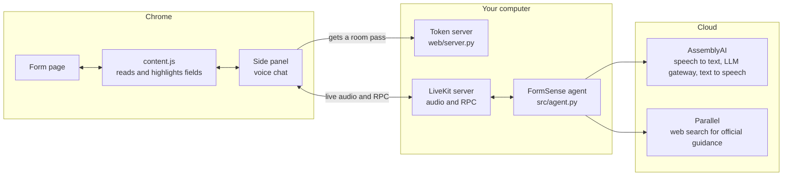
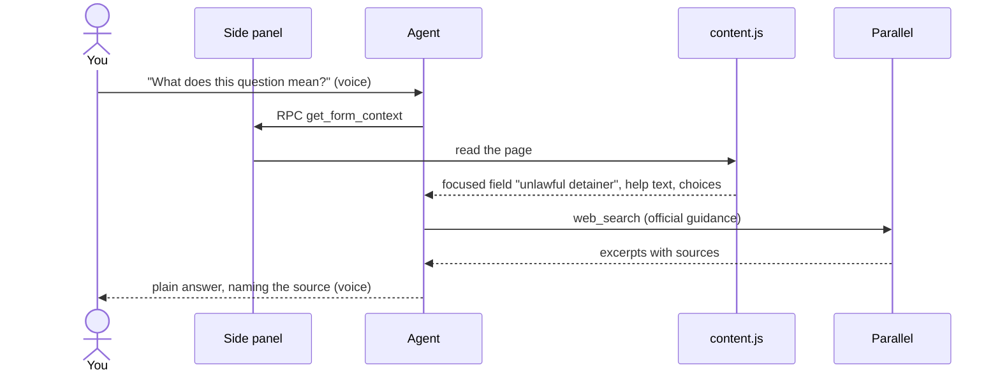

# FormSense

**A voice copilot in your browser that explains any form field, out loud, with official sources.**

Click a field, ask "what is this asking for?", and FormSense tells you in plain words. It reads the form you're on, looks up official guidance when a term needs it, and points at the fields you still have to fill in.

> Demo video: coming soon.

## Why

Forms like the DS-160 visa application or a driver's license application are full of questions that are hard to read: legal terms, unclear options, help text buried on another site. FormSense sits beside the form and answers questions while you type, so you never have to leave the page to search.

## What it can do

| Ask | FormSense |
|---|---|
| "What is this asking for?" | Reads the field you clicked and explains it, with an example answer |
| "What does unlawful detainer mean? Is that the same as being evicted?" | Searches for official guidance and answers, naming the source |
| "Where do I put my email?" | Scrolls to the field and outlines it |
| "What do I still need to fill in?" | Lists the required fields that are still empty, and highlights the first one |

It explains; it doesn't decide for you, and it never fills in or submits anything.

## How it works



1. **The side panel** gets a short-lived LiveKit token from the local token server and joins a private room. The token tells LiveKit to send the FormSense agent into the same room.
2. **Your voice** travels to the agent over LiveKit. AssemblyAI turns it into text and decides when you've finished speaking.
3. **The LLM** (through AssemblyAI's LLM gateway) chooses a tool:
   - `get_form_context` reads the form. The agent calls the side panel over LiveKit RPC, and the panel asks `content.js` in the page for the field you clicked, plus every field's label, help text and choices.
   - `highlight_field` scrolls to a field and outlines it.
   - Parallel's `web_search` finds official guidance for legal and official terms.
4. **The reply** is spoken by AssemblyAI's text to speech, and the transcript appears in the panel.

One question, start to finish:



## Privacy and safety

- **No typed values:** `content.js` reports each field's label, help text, choices, and whether it's filled in. It never sends what you typed. Password and file fields are skipped.
- **Visible:** the panel shows a note every time the page is read or a field is highlighted.
- **Read-only:** FormSense can't fill in or submit forms.
- **Local first:** the LiveKit server and token server run on your computer. Only audio and text go to AssemblyAI, and search queries go to Parallel.
- **Limited reach:** for now the extension only runs on the local practice form (`localhost:3000`).
- **Not legal advice:** FormSense gives general information and names its sources.

## Run it

**You need:** Windows, macOS or Linux; Python 3.10 to 3.13; [uv](https://docs.astral.sh/uv/getting-started/installation/); Chrome; an [AssemblyAI key](https://www.assemblyai.com/dashboard); and optionally a [Parallel key](https://platform.parallel.ai) (without one, web search uses a free, rate-limited tier).

1. Install dependencies:

   ```sh
   git clone https://github.com/rishabshukla-code/formsense.git
   cd formsense
   uv sync --frozen
   ```

2. Copy `.env.example` to `.env.local` and add your keys.

3. Get the LiveKit server: download `livekit-server` for your system from [LiveKit releases](https://github.com/livekit/livekit/releases) (tested with v1.13.11). Put it in `tools/livekit/`, or anywhere on your PATH.

4. Start everything: double-click `start-web.bat` on Windows, or run:

   ```sh
   uv run python web/run.py
   ```

   This starts the LiveKit server, the agent and the token server. It opens the browser once the agent is ready.

5. Load the extension: open `chrome://extensions`, turn on **Developer mode**, click **Load unpacked** and choose the `extension` folder. Pin **FormSense** from the puzzle-piece menu.

6. Open the practice form at http://localhost:3000/practice, click the FormSense icon, then click **Start talking**. The first time, the panel will ask you to allow the microphone.

More detail, and how to test without loading the extension: [extension/README.md](extension/README.md).

**Microphone not working?** If the green level bar in the panel doesn't move when you talk, Chrome is probably using the wrong microphone. Pick your real one at `chrome://settings/content/microphone`.

## Project layout

| Path | What it is |
|---|---|
| `src/agent.py` | The FormSense agent: instructions, `get_form_context` and `highlight_field` tools, Parallel web tools, voice pipeline |
| `extension/` | Chrome extension: side panel (`sidepanel.js`), page reader (`content.js`), microphone setup |
| `web/server.py` | Token server; also serves the practice form |
| `web/run.py`, `start-web.bat` | One-command launcher |
| `web/static/practice.html` | Practice form (a made-up rental application) |
| `tests/` | Unit and live tests (`uv run pytest -q`) |

## Built with

[LiveKit Agents](https://docs.livekit.io/agents/) · [AssemblyAI](https://www.assemblyai.com/) streaming speech to text, LLM gateway and text to speech · [Parallel](https://parallel.ai/) web tools over MCP · Chrome extension (Manifest V3, side panel, content script) · LiveKit RPC between the agent and the browser

## Roadmap

- [x] Voice chat in a Chrome side panel
- [x] Read the form and explain the clicked field
- [x] Official sources for legal and official terms
- [x] Highlight fields, and list what's left
- [ ] Demo video
- [ ] Real websites beyond the practice form, starting with simple public forms
- [ ] Optional "fill this in for me", always with confirmation, never submitting

## Credits

Built on the [AssemblyAI + Parallel voice starter](https://github.com/hsingh-aai/assemblyai-parallel-voice-agent). Its original guide to the terminal mode and the three Parallel tools is in [docs/starter.md](docs/starter.md).
